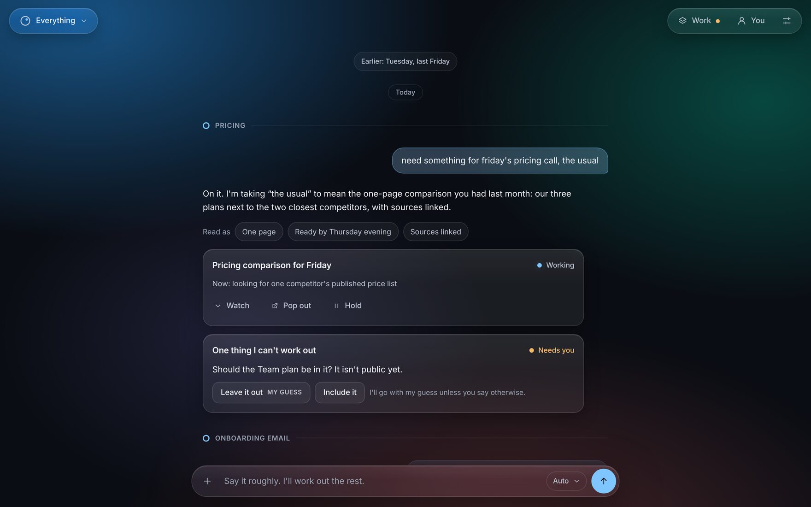
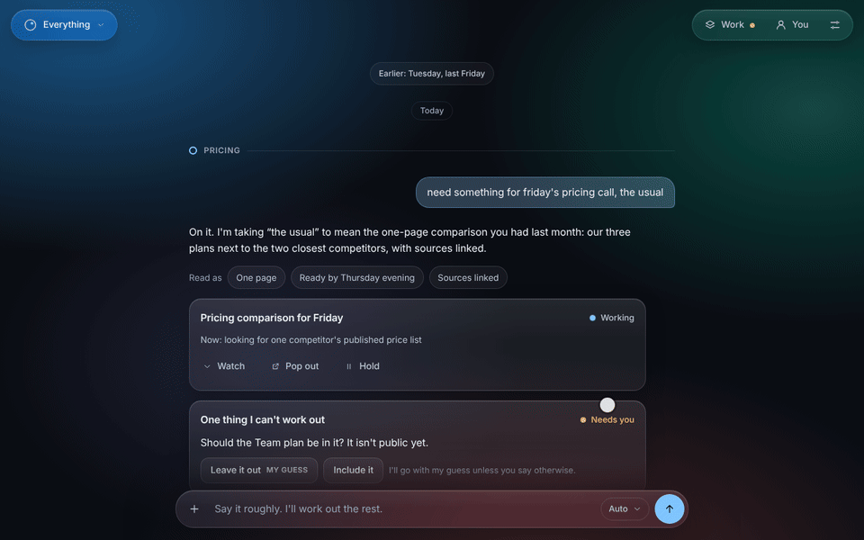
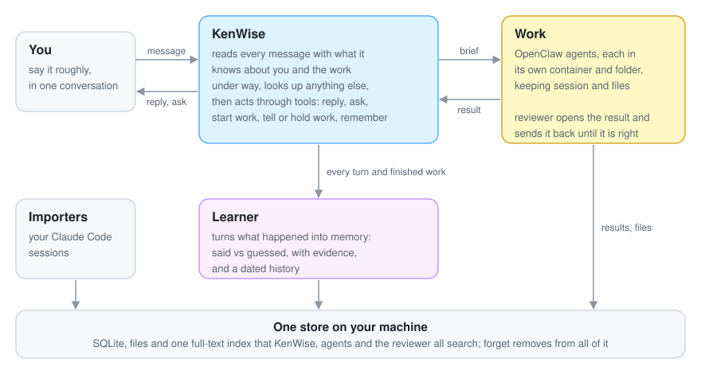
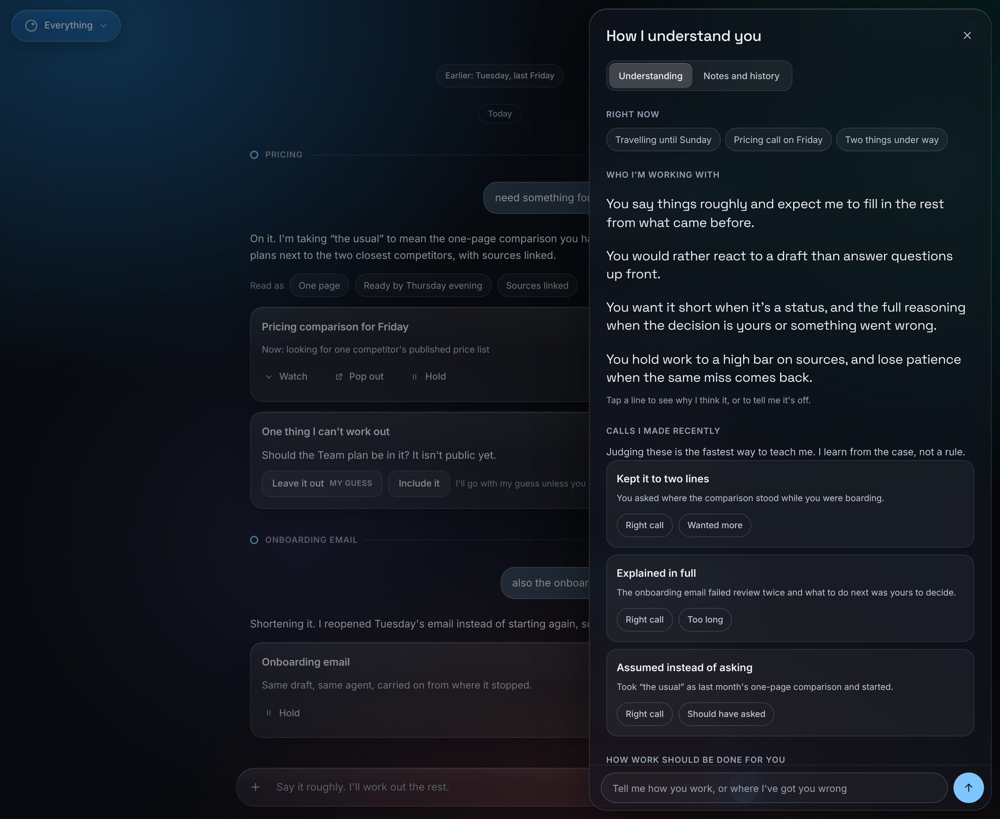

<p align="center"></p>
<p align="center"><sub>Design preview of the interface being built now. See <a href="#status-early">Status</a> for what runs today.</sub></p>

# KenWise

**One assistant that understands you, and keeps everything in order so you don't have to.**

Most AI assistants are an empty chat window and a list of facts about you. KenWise is meant to work like a good human assistant who has been with you for months: it knows how you talk, what you are in the middle of, and what "the usual" means. You say things roughly, in one ongoing conversation, and get what you meant. Agents do the work in the background, and you only hear about it when it is right.

### What makes it different

- **It understands what you mean.** Every message is read with who you are, what you're in the middle of and what came before. When something is unclear, KenWise drafts on a guess it states out loud instead of quizzing you. No keyword rules decide what "stop" or "the usual" means: a model judges each time.
- **One place, organised for you.** You never sort chats, folders or tabs. Talk in one conversation and KenWise keeps the threads of work apart: a remark today and a decision next week about the same project land together, and you can hold or reopen any of it. *(Grouping by work and watching work live are being built; today all of it lives in one store with one search.)*
- **Context across everything, without the bloat.** KenWise can reach every conversation, every result, its memory and your imported Claude Code sessions, but it doesn't stuff them into the prompt. It carries a short picture of you and what's under way, and looks up the rest only when it needs it, the way a coding agent reads a codebase.
- **Memory that grows like a person's, not a list of facts.** KenWise forms an understanding of who you are and how you like work done, and judges each case from it rather than turning one remark into a rule. It keeps what you said apart from what it guessed, with the reason for each guess, lets old beliefs become history when you change, and keeps a dated story of what happened. You can see why it thinks anything, correct it, or make it forget.
- **Work comes back done.** Agents carry the work out; a reviewer opens the real result and sends it back until it matches what you meant. Work is never lost: it can be steered, held, picked up later or reopened.
- **Yours, on your machine.** Everything is in one local store. The page only answers on localhost, and agents run in containers that see only their own work folder.

<p align="center"></p>

## Status: early

KenWise is a working daemon you can run today, and an interface that is still being built.

- **Runs today:** the whole loop above, with OpenClaw agents in docker, memory learnt in the background, forget, search over everything, and import of your Claude Code sessions. The page is the approved interface's shell: one ongoing conversation that updates live, with work cards, the Work sheet, look settings, notes and history, search, and a phone layout. `npm run verify` checks 59 behaviours KenWise should have, with a scripted model: 57 hold. The two that don't are about reaching you when the page is closed, which isn't built.
- **Real models:** so far KenWise has only been run on two small models, Claude Haiku 5.5 and muse-spark. In the last fully graded run they passed 6 and 5 of 17 hand-graded scenarios. Most failures came from six gaps that have since been fixed, and the re-run after those fixes is not finished. Whether KenWise really "gets you" on a strong model has not been measured yet.
- **Being built:** the parts of the interface in the pictures above that need new engines (the live feed and pop-out, threads of work, the portrait of you, models and accounts), signing in with accounts you already have instead of one API key, a router that learns which model suits which work, and reaching you when you're away. See the [roadmap](docs/ROADMAP.md).
- **Name:** KenWise was called EV while it was being built. The code, the `EV_*` settings and some internal docs still use that name.

## Install

macOS or Linux, with [Node.js](https://nodejs.org) 22.19 or newer, git, and [docker](https://docs.docker.com/get-docker/) for the agents:

```bash
curl -fsSL https://raw.githubusercontent.com/vulbsti/KenWise/main/install.sh | bash
```

The script puts KenWise in `~/.kenwise`, installs its one npm dependency, builds the container the agents run in, and links a `kenwise` command into `~/.local/bin`. It never uses sudo. Run it again to update, or run `kenwise update`. To install from a clone instead: `git clone https://github.com/vulbsti/KenWise && cd KenWise && ./install.sh`.

KenWise reaches models through [OpenCode Go](https://opencode.ai) today, so put your key in `~/.kenwise/.env`:

```bash
OPENCODE_API=...
```

## Quickstart

```console
$ kenwise open
KenWise is running: http://127.0.0.1:4317/?token=…
```

That starts the daemon in the background and opens KenWise in your browser. Say something the way you would to a colleague who knows you, such as "need something for friday's pricing call, the usual". The first time, KenWise knows nothing about you, so expect it to ask more. It learns from every turn.

| Command | What it does |
| --- | --- |
| `kenwise open` | Start the daemon if needed and open KenWise |
| `kenwise start`, `kenwise stop`, `kenwise restart`, `kenwise status` | Run the daemon in the background. Stopping keeps all work; it carries on at the next start |
| `kenwise logs` | Follow the daemon's log |
| `kenwise update` | Pull the latest KenWise, reinstall and rebuild the agent container |
| `kenwise run` | Run the daemon in this terminal |

To bring in what you've already told Claude Code, see [importing sessions](docs/configuration.md#import-your-claude-code-sessions).

## How it works

<picture>
  <source media="(prefers-color-scheme: dark)" srcset="assets/architecture-dark.svg">
  
</picture>

One rule shapes the whole system: **the code owns facts, the models own meaning.** That a message is saved, that work is never lost, that a forgotten thing is gone: code does these, and tests prove them. What you meant, which work "stop" refers to, whether a result is good enough: a model decides these every time, and acts only through a small set of tools.

1. **Inbox.** Every message is saved the moment it arrives and handled in order, one at a time. A message that arrived just before a crash is answered after the restart.
2. **KenWise.** The main model reads the message with your profile, the dated history and the open work. It can search and read anything else (any conversation, any result in full, memory, imported sessions), then acts through tools: `reply`, `ask`, `start_work`, `message_task` (steer, answer, hold, carry on or reopen work), `remember` and `forget`. It has no tool that executes anything.
3. **Work.** Each piece of work runs in an [OpenClaw](https://www.npmjs.com/package/openclaw) agent in its own container, which sees only its own folder. A reviewer opens the files it delivers and sends them back until they meet the brief. When it stops making progress, the problem becomes a question for you.
4. **Learner.** In the background, it turns every turn and finished piece of work into memory (facts, preferences, goals, working agreements, passing state, lessons from work that went wrong) and a dated history. Only your own words, quoted exactly, count as said by you. Everything else is a guess with its evidence attached.

More detail: [how KenWise runs work](docs/assistant/OPENCLAW_POC.md) · [memory](docs/assistant/MEMORY_TYPES.md) · [configuration](docs/configuration.md) · [the behaviours KenWise aims for](verify/BEHAVIOURS.md)

<p align="center"></p>
<p align="center"><sub>Design preview: KenWise shows what it believes about you, and why, so you can correct it.</sub></p>

## Your data

Everything KenWise keeps (conversations, work, results, memory and history) is in `~/.kenwise/data`, on your machine. The page listens only on `127.0.0.1` and needs the token printed at start; other local programs can use the API with the token in `data/api-token`. Your messages, and whatever the agents work on, are sent to the model provider you configure, and agents can search the web. Erasing a memory also erases the messages it was learnt from and removes them from every history line and from search. See [SECURITY.md](SECURITY.md).

## Check it

```bash
npm test          # invariants: store, inbox, memory write rules, security boundaries, review loop
npm run verify    # 56 behaviours, checked in seconds with a scripted model
npm run qa        # scripted scenarios against a real KenWise and a real model, graded per scorecard
npm run qa:arc    # a simulated person over weeks, scored for understanding and drift
```

The behaviour checks are written as judgement, not rules: each pairs two situations that look alike but mean different things, and KenWise passes only if it treats them differently. See [verify/README.md](verify/README.md) and [qa/README.md](qa/README.md).

## Limits

- **Early.** Only measured on small models so far, and the numbers above are the honest state.
- **One model provider today.** OpenCode Go, or any OpenAI- or Anthropic-compatible endpoint through `EV_MODEL_URL`. Signing in with other accounts is being built.
- **macOS and Linux only.** Windows may work under WSL2 but is untested.
- **One person per install.** KenWise is built to understand one person, not a team.

## Contributing and license

Bug reports, design discussion and pull requests are welcome. Start with [CONTRIBUTING.md](CONTRIBUTING.md), and if you work with a coding agent, point it at [AGENTS.md](AGENTS.md). Please follow the [Code of Conduct](CODE_OF_CONDUCT.md), and report security problems privately as described in [SECURITY.md](SECURITY.md). Licensed under [Apache-2.0](LICENSE).
